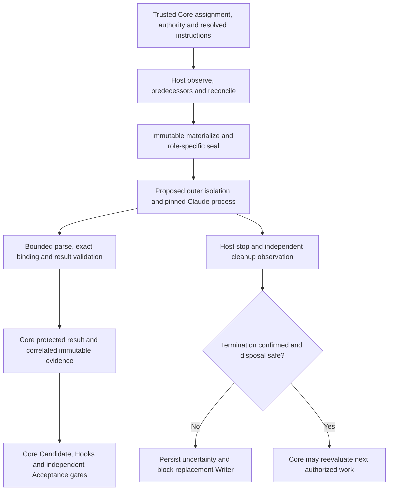

# Proposed adapter architecture and safety boundaries

All new behavior on this page is **Proposed integration**, not an implementation.
Provider observations are in the [source register](sources.md); unproven controls
are **Unknown risk**. Existing code is the normative interface owner, not a
recipe for bypassing Core. References below identify the inspected baseline in
the [dossier index](README.md).

## Existing owners and integration seams

**Verified Nibfin behavior, bounded extent:** the following exports and validators
exist in the inspected source. `test/agent.test.mjs` and
`test/fixtures/agent-host.mjs` exercise a bounded Node host, not Claude or a
production native sandbox. This delivery does not rerun those tests or expand
their documented extent. See [interface contracts](../../interfaces.md), sections
“Protected interface version 5,” “Agent host interface version 1,” and Candidate
version 2. No external Action or CLI implementation was inspected.

| Existing owner | Proposed producer/consumer correspondence and rejection boundary |
| --- | --- |
| `src/agent.mjs`: `validateEnvironments`, `validateLogin` | Trusted local host observes actual service account, Agent credential domain and registration inventory; never trust provider login text. Distinct instances keep separate GitHub identities, workspaces and services. One environment can share its Agent login; different environments cannot. Create count remains total instances, default 2, positive integer; registration never expands it. Standby is separate from Issue permission. |
| `createAgentAdapter(host)` / `prepare` | Core injects observe/materialize/seal/execute/stop/cleanup/predecessors/reconcile functions; no checkout-selected implementation. Validate complete assignment and permission, observe isolation, reconcile all predecessors, reconstruct exact immutable references, seal role mode, then issue a one-use handle. No new executor outside this seam. |
| `src/protected.mjs`: `roles`, `skillForRole`, `resolveInstructions`, `invokeProtected` | Core supplies authenticated assignment, approved customization and fresh requirements/authorization. Proposed host receives resolved instructions only after schema-5 gates. Repository and shared defaults cannot override identity or gates. |
| `validateProtectedRequest`, `validateBinding`, `validateRoleResult` | Host correlates transport to the original request; validates provider content strictly, then submits a RoleResult with exact trusted binding. Provider JSON alone is not authenticated evidence. Never copy provider-supplied authority/permission or repair target into trusted state. |
| `src/workspace.mjs`: `prepareWorkspace`, `captureCandidate`, `reconstructCandidate`, `verifyCandidate`, `candidateEvidence`, `compareCandidateEvidence` | Core captures version-2 Candidate base/tree/binary diff/paths and complete snapshots, carries identities across Runs and invalidates changed evidence. Adapter consumes immutable references; it neither stages a replacement index nor commits or publishes. |
| `src/obligations.mjs`: `parseCandidateInventory`, `validateInventory`, `validateCandidateObligations`, `validateCandidatePath` | Core verifies the single Shape inventory against Scope and independently observed hook configuration; capture includes mandatory ignored artifacts. Adapter cannot replace missing evidence with mutable checkout files. |
| `validateCleanup` and host `stop`, `cleanup`, `predecessors`, `reconcile` | Independent host observation must correlate execution/workspace/assignment/operation/Run/Attempt; only confirmed termination plus safe disposal permits reuse of resources through a fresh assignment. Local adapter reservations do not establish distributed exclusion. |

The UTF-8 Agent materialization seam cannot silently represent arbitrary binary
inputs. Candidate snapshots have base64 encoding in their own version-2 contract.
A future host must faithfully bridge supported representations or block; it may
not decode lossily or invent an alternative schema. Public/serialized interface
changes require separately authorized versioning and producer/consumer integration
proof; no such change is made here.

## Roles, sessions and output

| Protected role | Skill | Filesystem mode | Required independent role evidence in schema 5 |
| --- | --- | --- | --- |
| shape | shape | read-only | Host may require operation-specific predecessors |
| shape-validator | shape | read-only | shape |
| shape-diagnosis | shape | read-only | shape |
| shaper-review | shape | read-only | shape, shape-validator, deliver, accept |
| deliver | deliver | workspace-write | shape-validator, plus Core's publication/operation gates |
| accept | accept | read-only | deliver, plus Core's Candidate/Hook gates |
| Hook class | No new Skill | read-only input | Separate null-instruction execution; both Core Hook passes |

The host must provide every relevant predecessor participant, not only the
minimum role list. Independent validator/diagnosis/Accept/final review cannot
reuse a supplied predecessor Core session. Proposed Claude launches use fresh
provider context and credential/work directories for each role; resuming, forking
or sharing conversation history across roles is excluded. Provider session IDs
are diagnostic correlations only. Core's sessionId, requestId, resultId,
executionId, workspaceId and Actions source runId/attempt remain separately
assigned authenticated identities. A provider UUID does not establish independence.

Proposed invocation: select a pinned reviewed CLI and model, expose only approved
inputs in an externally enforced sandbox, supply Core-resolved prompt content,
request bounded schema-constrained output, and collect stdout/stderr/exit status
privately. Exact argv, settings and credential delivery are future reviewed
implementation decisions; S1–S4 constrain them. No bypass flag or operational
launch configuration is supplied by this dossier.

The parser must enforce byte/time limits, complete single terminal output,
expected schema, required fields/types, exact binding and correlated references.
Malformed, missing, truncated, duplicated terminal, unsuccessful or mismatched
output blocks. Nonzero exit or missing structured content cannot become success;
exit 0 and syntactically valid JSON are insufficient. Never salvage partial
output into completion. Provider-generated bindings are compared to authenticated
expectations rather than accepted as authority. Core persists the validated
schema-5 RoleResult and separately correlated host evidence; successful transport
can still contain a role rejection. Raw provider errors remain private and
redacted; public diagnostics contain only safe operation/status locators.

Preserve Binding's repository/Issue, authority, requirements, Scope/Shape/Candidate,
work/repair/incident cycles, source relationship, versions, instruction and prior
inventory identities. Source provenance is not successful prior-result proof.
`digest(value)` is SHA-256 of UTF-8 `JSON.stringify(value)`, including quotes for
strings and existing property order. Preserve exact original objects and strings;
never hash raw string bytes or claim canonical JSON. Git blob identities use the
separate Git header-plus-bytes algorithm. Content hashes authenticate nothing by
themselves. Every changed Candidate/base/artifact/hook invalidates dependent old
Accept, Review and CI evidence. Core alone schedules live native dependencies,
executes Hooks, dispatches independent reviewers, publishes, commits and merges.

## Threat and failure analysis

All rows below are proposed trusted enforcement. No native implementation or
measurement is claimed. S1–S5 refer to dated official observations in sources.md.
Each remaining uncertainty keeps the proposed configuration Unverified.

| Boundary / threat | Documented basis or limit | Proposed trusted enforcement | Unknown risk and fail-closed condition |
| --- | --- | --- | --- |
| ISO-02 whole-process filesystem/network escape | S5 shell boundary is incomplete | Outer VM/container/OS policy encloses provider, file tools and every descendant; deny symlink/mount aliases, host sockets and external paths; Agent egress only approved provider endpoints | Native backend closure/races unproven; missing external enforcement blocks before credentials/execution |
| File tools, subprocess and helper escape | S2 tools are not OS policy; S5 exclusions | Restrict capabilities plus independent OS denials for direct file access, DNS, raw sockets, subprocesses, MCP/plugins/LSP and credential helpers | Any unchecked helper or unsandboxed retry blocks; no tool/prompt allowlist counts as proof |
| Context/configuration injection | S1/S4 discovery, reloading and skipped invalid settings | Reconstruct reviewed context, isolate home/ancestors, freeze effective settings; reject unexpected CLAUDE.md, memory, plugins, hooks, MCP and mutable managed inputs | Complete context closure not proven; unknown/changed source or ignored required setting blocks, even under approved custom instructions |
| Credentials and leakage | S3 account prerequisites; S5 inherited secrets | Core gh, GitHub write credentials, signing/controller keys never enter sandbox. Only narrow Agent authentication may cross the approved boundary; minimize scope/TTL, isolate files/refresh helpers, scrub child env and redact before retention | OAuth refresh/API/cloud identity confinement unproven; excess exposure, token override or unsafe logging blocks. Never request Owner's provider secret |
| ISO-06 independent read-only reviewers | Existing role table and host mode; provider prompts insufficient | Read-only mounts and denial of all write channels; separate Core sessions/executions/workspaces and provider histories; immutable Candidate input | Alternate write path or shared context blocks. Deliver alone writes approved workspace; reviewer tooling cannot mutate Candidate |
| Environment/service/registration confusion | Existing validators; S3 service login not tested | Actual OS/service account observations; environment credential domains fixed; per-instance registration/workspace/service isolation. Core gh login required for local contexts only, not hosted Jobs | Missing account/identity, GH_TOKEN/GITHUB_TOKEN substitution, 401/403 or unknown permission blocks; login confers neither registration nor Issue/Merge authority |
| Public versus Private checkout | S4/S5 input can start helpers | Treat both as hostile; Public forks require trusted fixed execution source and no persistent credentialed exposure; Private collaborator access is not trust to read another member's credentials | Cross-workspace/host/service access unproven; unsafe long-lived Runner exposure deliberately excluded. Service account cannot inherit personal developer home/keychain by assumption |
| Evidence reconstruction and omission | Existing immutable references and Candidate owners | Verify every reference before exposure, including ignored required artifacts and hooks; keep immutable private store, original digest semantics, safe paths, complete inventory | Missing/binary-unsupported/changed input blocks, never falls back to cache or mutable checkout; stale Run/Attempt/Candidate/assignment rejected |
| Provider hooks versus Core Hooks | S5 provider hooks outside shell; existing separate Hook class | Disable or confine provider hooks as untrusted process code. Core runs approved pre-commit/prepare-commit-msg/commit-msg twice in separate credential-free/network-denied isolation and verifies index tree, original message, sources/artifacts and receipts | Provider hooks never replace Core passes. Missing tools, network requirements, changed index/message or unknown receipt blocks; no ceremonial success |
| Cancellation, timeout, detached child survival | S1 termination documentation is narrower than host proof | Host-controlled deadline and whole-tree containment; stop, externally enumerate descendants/resources, remove mounts/workspace and revoke narrow credentials; persist correlated cleanup observations | Parent exit, signal delivery or provider claim cannot prove termination. Running/failed/unknown termination or incomplete disposal blocks replacement Writer across hosts/Runs until independently reconciled |

## Implementation-size uncertainty

No LOC completion target applies. Future work must separately estimate: native
Host containment (kernel/backend and architecture differences); credential broker
and refresh (auth choice/service identity); context closure (provider version and
managed policy); bounded result parser and evidence retention (exact protocol and
binary materialization); process-tree disposal/reconciliation (OS facilities);
and integration/negative tests (available hosts/accounts and independent observer).
Existing validators can be reused, but do not establish those native effects.
Neither a sibling release nor a future undocumented harness fills these gaps.
